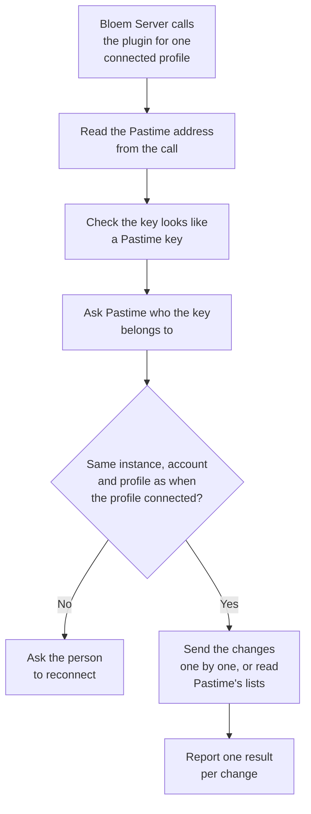
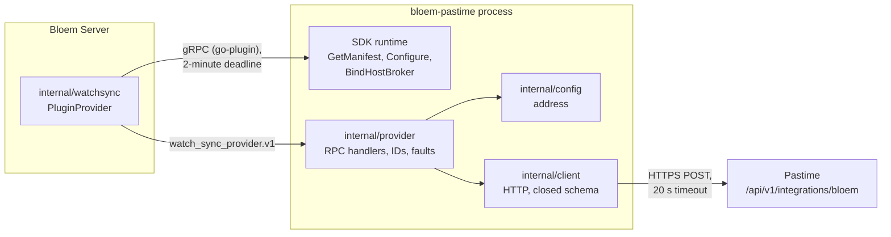

# How the Pastime plugin works inside

> How the Pastime plugin handles each call from Bloem Server: the checks it makes, the names it
> gives plays and lists, and how it reports failures.

The [front page](../README.md) says what the plugin does for an administrator. This
page walks through what happens inside one call, how the plugin names plays and lists,
how a failure is reported, and how favourites, watchlist and ratings travel.

## One call, start to finish

The plugin has no timers, caches or files. Everything it does happens inside a call
from Bloem Server, so any number of copies of it behave the same.



1. **Find Pastime.** The address comes with every call, so a changed setting applies
   to the next call. Without a usable address nothing is sent, and the call waits
   without using a retry.
2. **Check the key.** A key that does not look like a Pastime key never reaches
   Pastime.
3. **Check who the key belongs to.** Pastime says which Pastime **instance**, account
   and profile the key is bound to. These must match what Bloem Server stored when the
   profile connected. If they do not, the person is asked to reconnect.
4. **Do the work.** Send each change in order, or read one page of Pastime's lists.
5. **Answer per change.** Each change gets its own result, under Bloem Server's own
   name for it.

A connection stores the key and those three names, with no expiry date. Pastime keeps a
key alive by extending its expiry while it is used, so the plugin never has to refresh
it.

## Names that stay the same

Pastime remembers plays, playback state and lists under names that the plugin works
out from Bloem's own IDs. The formulas are fixed, byte for byte, so Pastime recognizes
what it already has and never counts a play twice.

- **A play's name** comes from the account, the profile and the watch-history entry.
  The stop at the end of playback, the history export and any retry of the same
  viewing all share it.
- **A change's name** comes from the change's exact content. Sending the same change
  again repeats the name; a different change gets a new one. That matters because
  Pastime refuses a known name with different content.
- **The order of changes** is the time they happened, in microseconds, so a change
  that arrives late does not overwrite a newer one.

## How failures are reported

The rule is simple: a problem with the connection or with Pastime is reported for the
whole call, and Bloem Server then sets aside every per-change result in it. A problem
with one change is reported for that change only.

- **Pastime is down or answers strangely:** the whole call waits. Bloem Server marks
  nothing and uses no retry. Sending again is safe, because the names above stop
  Pastime from recording anything twice.
- **One change trips a Pastime error while Pastime is otherwise up:** that change alone
  is tried again later.
- **Pastime is still loading a title:** that change alone is tried again later.
- **Pastime asks to slow down:** that change and the rest of the batch wait for the
  pause Pastime asks for.
- **Time runs short:** each call has two minutes, and each request to Pastime may take
  up to 20 seconds. When fewer than 25 seconds remain, the rest of the batch waits for
  the next run.
- **Pastime cannot match a title, or rejects a change:** that change is refused.
- **The key is refused or belongs to another profile:** the person is asked for a new
  key.
- **The account has no tracking access, or Pastime turned off Silo sync:** the call
  waits and shows the reason. These never count against the five retries, because
  Pastime denies access to everyone but its administrators while its access feed is
  late.

## Favourites, watchlist and ratings

Changes made in Bloem go to Pastime, removals included (favourite and watchlist
removals once the profile turns on their switches). A removal comes from Bloem Server
without a time, and sometimes without the title's outside IDs; the plugin then uses
the moment it received it, and finds the title from the key it was imported under.

Reading goes the other way, page by page. Pastime's favourites, watchlist and ratings
come back, and so do finished plays and resume points that Pastime recorded from
other sources (never the ones Bloem Server sent). The plugin tells Bloem Server that a
page is never the complete list, so a title that is missing from a page is never taken
as removed. Only a removal that Pastime names is passed on: a removed favourite,
watchlist item or rating, and a movie or show deleted from the profile's Pastime
library. Bloem Server applies those only to items the connection synced and only as
the connection's removal settings allow.

## Example: a retry that changes nothing

This example is made up.

1. Bloem Server hands the plugin three of Sam's finished plays.
2. Pastime records the first. On the second it answers with an internal error.
3. The plugin asks Pastime who Sam's key belongs to, and gets the same answer as
   before. So the second play alone is marked "try again", and the third is sent and
   recorded.
4. On the next run, Bloem Server sends the second play again. It carries the same
   play name, so Pastime records it once, whatever happened the first time.

## Words used in the code

| On this page | In the code |
| --- | --- |
| A call | an RPC: `GetAccount`, `ExchangeAPIKey`, `ApplyEvents`, `ListRemoteState` (`internal/provider/provider.go`, `remote_state.go`) |
| Find Pastime | `config.Origin` reading `provider_config.values["pastime.pastime_url"]` |
| Check the key | `client.ValidKey` |
| Who the key belongs to | `client.Binding` from `credentials:inspect`, compared by `sameBinding` |
| What Bloem Server stored | the credential's `secret_attributes` `instance_id`, `account_id`, `profile_id` |
| A play's name | consumption ID `play_…` (`consumptionID` in `internal/provider/ids.go`) |
| Playback and list names | entity IDs `media_…` and `state_…` (`playbackEntityID`, `personalEntityID`) |
| A change's name | wire event ID `pevt_…` (`wireEventID`) |
| The order of changes | revision, Unix microseconds (`revision`) |
| Reported for the whole call | a response-level fault (`syncFault`, `connectionFault` in `internal/provider/faults.go`) |
| Reported for one change | a per-event result (`eventOutcome`, `afterInternalError`) |
| Time runs short | `requestReserve` (25 s) and `deferred()` |
| A page is never the complete list | `complete_snapshot=false` |
| A removal Pastime names | `removed=true`, passed on as a tombstone (`listRemoval`, `watchedRemoval`) |

## For developers

The plugin is one `watch_sync_provider.v1` capability served with the SDK's
`ServeManifestWithOptions`. The SDK's default runtime answers `GetManifest` with the
checksum-stamped embedded manifest, accepts `BindHostBroker` without dialing the broker
(it only records the broker ID), and passes `Configure` entries to a callback that
accepts any settings and only logs a warning (without the address) when the Pastime address is missing or invalid.
Everything else happens inside the RPCs Bloem Server calls; there are no workers, timers,
caches or files, so any number of plugin processes behave the same.

```
cmd/bloem-pastime    main, embedded manifest.json
internal/config      Pastime address from the call's provider_config
internal/client      HTTP calls to Pastime's sync routes, closed-schema decoding, Fault
internal/provider    RPC handlers, translation, local IDs, fault mapping
scripts/             manifest check (Python) and release packaging/check (Go)
```



### One call

Every authenticated RPC (`GetAccount`, `ApplyEvents`, `ListRemoteState`) does the same
three things first:

1. Read `provider_config.values["pastime.pastime_url"]`. Silo flattens installation
   settings as `<config key>.<field>` and puts declared non-secret fields in `values`.
   A missing or invalid address is a TEMPORARY fault, so nothing is marked and no
   retry attempt is spent.
2. Check the stored key's shape (`ptbs_` prefix with at least one more byte, printable
   ASCII without spaces, at most 256 bytes). A malformed stored key is
   INVALID_CREDENTIAL without a request.
3. Call `credentials:inspect` and require the stored secret attributes `instance_id`,
   `account_id` and `profile_id` to equal Pastime's answer. A mismatch asks for a
   reconnect: INVALID_CREDENTIAL during a sync, PERMISSION_DENIED from `GetAccount`.

Before step 1, each of these RPCs and `ExchangeAPIKey` check that the capability ID is
`pastime` (otherwise INVALID_REQUEST, "This request is not for the Pastime
capability."). Earlier still, `ApplyEvents` checks it has 1 to 100 events (the
manifest's `max_batch_size`; otherwise INVALID_REQUEST, "Send between 1 and 100
events."), and `ListRemoteState` checks for a page size from 0 to 100 and at most the
five known state kinds (favourites, watchlist, ratings, watched plays and resume points) (otherwise INVALID_REQUEST, "Silo asked for a read Pastime
does not offer.").

A connection made through `ExchangeAPIKey` stores the key and those three
attributes, with no expiry, refresh token, type or scopes. Silo never refreshes a
credential without an expiry, so `RefreshCredentials` only exists to ask for a
reconnect (INVALID_CREDENTIAL, "Create a new key on Pastime's Connect Silo page and
reconnect."), and the plugin never returns `updated_credentials`. Pastime keeps keys
alive by extending their expiry while they are used. `InitAuthorize` and
`ExchangeCode` answer INVALID_REQUEST ("Pastime connects with a key.").

`ExchangeAPIKey` trims the pasted key, refuses one that is not key-shaped
(INVALID_CREDENTIAL, "This is not a Pastime key. Create one on Pastime's Connect Silo
page."), and calls `credentials:inspect`. A key Pastime refuses is INVALID_CREDENTIAL
with "This Pastime key is not valid or has expired. Create a new key on Pastime's
Connect Silo page."; other failures map as in the [answers table](protocol.md#answers),
with PERMISSION_DENIED for access problems. `ExchangeAPIKey` and `GetAccount` return
the account with `external_subject` set to Pastime's `profile_id` and `username` and
`display_name` set to the Pastime profile `name`.

### IDs

Pastime keys recorded plays, entity state and personal state on IDs derived from
Bloem's own IDs. `internal/provider/ids.go` computes them byte for byte (`ids_test.go`
pins golden vectors):

| ID | Formula |
|---|---|
| Playback entity | `"media_" + hex(sha256(json(["<media_item_id>"])))` |
| Personal entity | `"state_" + hex(sha256(json(["<lane>","<media_item_id>"])))`, lane `favorite`, `watchlist` or `rating` |
| Consumption | `"play_" + hex(sha256(json(["<account_id>","<profile_id>","<watch_history_id>"])))`, completions only |
| Revision | occurrence time in Unix microseconds |
| Wire event ID | `"pevt_" + hex(sha256(json(payload with event_id "")))` |

`json` is `encoding/json` with its defaults (no spaces, HTML escaping on). The account
and profile are the connection's binding, which for every connection equals the Silo
account and profile. A revision is zero, which Pastime rejects, for times at or before
the Unix epoch.

The wire event ID is a digest of the exact payload because Pastime refuses a known
event ID with a different payload while Silo reuses its own IDs
(`<OP>:<media_item_id>` for every list change of an item, a resumed session's START).
An exact retry repeats the ID; any other change gets a new one. Results go back under
Silo's event ID.

An older event arriving after a newer one on the same entity answers `stale`, and a
completion is still recorded once because Pastime checks the consumption ID
separately. An old completion never clears a resume point Pastime updated more than
five minutes after it.

### Faults

The rule: anything that concerns the connection or the service is a response-level
fault, so Silo ignores the batch's per-event results; anything that concerns one event
is that event's result. See [protocol](protocol.md#answers) for the full table.

- Service failures (5xx except `catalog_*`, transport errors, responses outside the
  closed schema) are TEMPORARY for the whole batch. Silo marks nothing and spends no
  attempt. Re-sending events applied before the failure is safe because of the
  payload-derived wire IDs and the consumption ID.
- A `500` can also be a Pastime bug that only one event triggers, which as a batch
  fault would hold the connection's oldest exports forever. After a `500` the plugin
  asks `credentials:inspect` again: when Pastime answers exactly as at the start of
  the call (same instance, account, profile and name), that event alone is
  RETRY/TEMPORARY (one of Silo's five attempts per run) and the batch continues;
  otherwise the batch fails as above. When too little time is left to ask, the event
  and the rest are deferred as below.
- Silo gives each watch-sync call two minutes (`pluginhost.DefaultWatchSyncTimeout`).
  Before each Pastime request the plugin checks that at least 25 seconds remain (the
  20-second request timeout and a margin); events that no longer fit are
  RETRY/RATE_LIMITED with a one-second `retry_after`, so Silo records the results so
  far and sends the rest on its next run without spending attempts.
- `503 catalog_loading` and `catalog_pending` retry that event only (RETRY/TEMPORARY,
  one of Silo's five attempts, with Pastime's `Retry-After` when it sends one); later
  events continue.
- `429` makes the event and every later one in the batch RETRY/RATE_LIMITED with
  Pastime's `Retry-After` (60 seconds when absent, because Pastime's limiter window is
  one minute; capped at 5 minutes); Silo keeps them pending without spending attempts
  and defers the connection.
- `404 no_match`/`not_found`, `409` and `413`/`415`/`422` reject that event. For a
  history export Silo treats a rejection as final.
- `401`, any other `403` (Pastime's `forbidden`) and a binding mismatch ask for a new
  key (INVALID_CREDENTIAL, nothing marked). `403 service_access_required` and `410`
  are TEMPORARY with their own message during a sync: Silo shows it as the run error,
  marks nothing, and sends the backlog once Pastime accepts the key again. Silo counts
  a PERMISSION_DENIED history batch as one failed attempt per export, and Pastime
  denies access to everyone but administrators while its access feed is late, so the
  plugin uses PERMISSION_DENIED only when connecting (`ExchangeAPIKey`, `GetAccount`).
- Cancellation and deadline errors from the request context count as transport
  failures (TEMPORARY).

### Personal state

Favourite, watchlist and rating changes go to `state/events:apply`. Silo sends
removals without a time and, when scheduled, without external IDs; the plugin uses the
receive time (to the microsecond, the same instant for every event in one call) as
occurrence and revision, and resolves the title from the key it was imported under:
`imdb:`, `tmdb:` and `tvdb:` keys are that ID, and `catalog:<n>` is Pastime's own
catalog ID, sent as `media.catalog_item_id`. The plugin never sends a watchlist
position, because Silo derives it from the batch and it would change between runs.

`ListRemoteState` reads `state:read` and reports every page with
`complete_snapshot=false`, so Silo infers no removal from an absent item. A request
that names no state kind asks Pastime for all five, because Pastime reads an empty list
as the favourites, watchlist and ratings only. Items come back as follows: a favourite,
watchlist entry or rating for a movie or series; a watched play (play count and last
watch time) or a resume point (progress percent below 100 and pause time) for a movie
or episode, an episode being named by its show's IDs and its season and episode
numbers. A removal
Pastime names (`removed=true`) is passed on as a tombstone, as described in
[the protocol](protocol.md#remote-state). Silo adds and re-keys matched items and
applies a tombstone only to items this connection synced.

Related pages:

- [The README](../README.md): what the plugin does, installation, connecting and
  building.
- [The Pastime sync protocol](protocol.md): every route, payload rule and answer.
- [What the plugin's checks prove](verification.md).
- [Watch provider plugins](https://github.com/Bloem-Studios/bloem-server/blob/main/docs/architecture/watch-provider-plugins.md)
  (Silo's page in Bloem Server): how the server drains exports and applies remote
  state.
