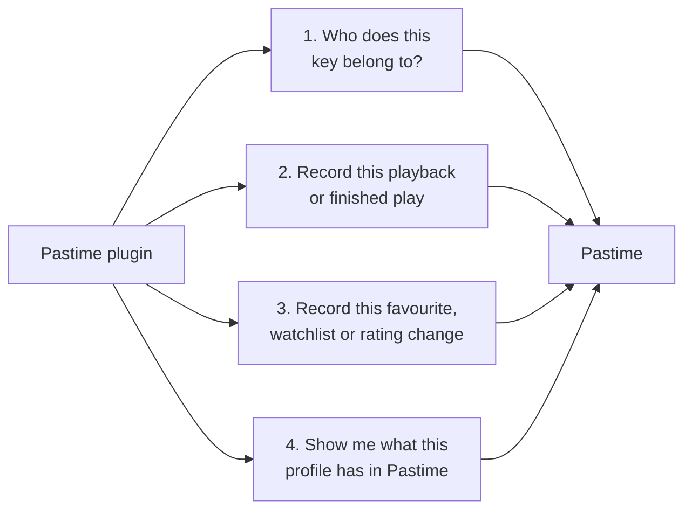

# The Pastime sync protocol

> The requests the Pastime plugin makes to Pastime's sync API, and how it turns Pastime's
> replies into answers for Bloem Server.

The plugin talks to Pastime in four kinds of request, always with one profile's key.
This page walks through what those requests ask, what the plugin says about a title,
how strictly it reads Pastime's replies, and then, for developers, every route,
payload rule and answer.

## What the plugin asks Pastime



1. **Who does this key belong to?** Pastime names its own **instance** (one Pastime
   installation), the account, the profile and the profile's name. The plugin asks
   this at the start of every call.
2. **Record this playback.** A start, pause or stop, with how far into the title it
   was. A finished play also carries the play's own name, so Pastime counts it once.
3. **Record this list or rating change.** Adding or removing a favourite or a
   watchlist entry, and setting or removing a rating.
4. **Show me what this profile has**, one page at a time: favourites, watchlist,
   ratings, plays recorded outside Bloem and resume points.

Pastime answers each change with **applied**, **stale** (it already has something
newer) or **no change**.

## How a title is named

Bloem and Pastime have different catalogs, so the plugin names a title by its
**outside IDs**: its TMDB, IMDb or TVDB number. An episode is named by its series'
outside IDs plus the season and episode numbers. A title that came from Pastime in
the first place can also be named by Pastime's own **catalog number**. When Pastime
cannot match a title, the change is refused and the others carry on.

## How strictly replies are read

The plugin trusts nothing it does not expect:

- **A good reply** must be exactly the agreed shape. A reply with an unknown field, or
  more than one megabyte, is treated as a broken agreement and nothing in it is used.
- **An error reply** is read only for its short code, such as `no_match`. Pastime's
  error messages are never kept, logged or shown to anyone.
- **A redirect** is refused, so the key never travels to another address.
- **A request for a pause** is honoured for at most five minutes.

## Words used in the code

| On this page | In the code |
| --- | --- |
| Who does this key belong to? | `credentials:inspect`, answered as `client.Binding` |
| Record this playback | `events:apply` with a `client.PlaybackEvent` |
| Record this list or rating change | `state/events:apply` with a `client.PersonalEvent` |
| Show me what this profile has | `state:read` with a `client.PersonalRead`, answered as `client.PersonalPage` |
| Applied, stale, no change | `status` `applied`, `stale`, `no_change` |
| Outside IDs | `external_ids` (`tmdb`, `imdb`, `tvdb`), `series_external_ids` for an episode |
| Pastime's catalog number | `catalog_item_id`, or a `catalog:<n>` `provider_item_key` |
| Short error code | `client.Fault.Code` |
| A broken agreement | local code `invalid_response` |
| A pause | the `Retry-After` header, capped at 5 minutes |

## For developers

All calls are `POST <Pastime address>/api/v1/integrations/bloem<route>` with exactly one
`Authorization: Bearer ptbs_…` header, `Content-Type: application/json`,
`Accept: application/json` and `User-Agent: bloem-pastime/<version>`. No cookie and no
`X-Pastime-Profile-ID`. Redirects are refused. Each request has a 20-second timeout.

A success is status 200 with exactly one JSON document of at most 1 MiB that decodes
with unknown fields disallowed. Anything else, including an unknown field, is treated
as a broken contract and trusted in no part. An error body is read only for its `code`
(at most 4 KiB, `^[a-z0-9_]{1,64}$`); messages are never kept, logged or returned.
`Retry-After` is read as seconds or an HTTP date and capped at 5 minutes. A key that is
not key-shaped is never sent (local code `invalid_key`); a failure without a usable
answer has status 0 and local code `transport_unavailable` or `invalid_response`.

### Routes

| Route | Request | 200 response |
|---|---|---|
| `credentials:inspect` | `{}` | `{"instance_id","account_id","profile_id","name"}`, all non-empty |
| `events:apply` | playback event | `{"status":"applied"\|"stale"\|"no_change","play_recorded":bool}` |
| `state/events:apply` | personal event | same |
| `state:read` | `{"kinds":[…],"cursor":"full-v1","page_token","page_size":0..100}`; `cursor` and `page_token` are left out when empty | `{"items":[…],"next_page_token","next_cursor","complete_snapshot","warnings"}` |

An event answer with any other `status` is a broken contract. These four routes are the
only ones the plugin calls.

### Playback event

```json
{"version":1,"instance_id":"…","account_id":"…","profile_id":"…",
 "entity_id":"media_…","event_id":"pevt_…","revision":1791981296789123,
 "operation":"start|pause|stop","occurred_at":"RFC 3339","completed":true,
 "consumption_id":"play_…","position_seconds":8100,"duration_seconds":8160,
 "media":{"kind":"movie|episode","external_ids":{"tmdb":"603"},
          "series_external_ids":{"tvdb":"81189"},"season":1,"episode":3,
          "title":"…","series_title":"…"}}
```

- Silo's `SCROBBLE_START`, `SCROBBLE_PAUSE` and `SCROBBLE_STOP` become `start`,
  `pause` and `stop`. `MARK_WATCHED` (history export) is a completed `stop`. Only a
  `stop` can be completed. A completion needs Silo's watch-history ID; without one the
  event is rejected.
- `consumption_id` is present exactly when `completed` is true.
- A completed event without a runtime sends `duration_seconds` 1; an uncompleted one is
  rejected.
- Positions and durations must be finite and at most 10,000,000 seconds, and a position
  cannot be negative.
- Movies need external IDs; episodes need series IDs, `season` ≥ 0 and `episode` ≥ 1.
  Only `tmdb`, `imdb` and `tvdb` IDs with a value are sent. Other media types are
  rejected. An episode also carries `title` and `series_title` (trimmed, at most 500
  characters, left out when empty), which Pastime uses to check the IDs and numbers and
  to find an episode or show that another catalog numbers differently.
- `occurred_at` must be after 1970 and at most 5 minutes in the future.
- An event the plugin cannot translate is REJECTED/INVALID_REQUEST without a request:
  "Silo sent a playback event Pastime cannot record."

### Personal event

```json
{"version":1,"instance_id":"…","account_id":"…","profile_id":"…",
 "entity_id":"state_…","event_id":"pevt_…","revision":…,
 "operation":"favorite_add|favorite_remove|watchlist_add|watchlist_remove|rating_set|rating_remove",
 "occurred_at":"RFC 3339","rating":8,
 "media":{"kind":"movie|series","external_ids":{"imdb":"tt0133093"},"catalog_item_id":"42"}}
```

- `rating` is present only for `rating_set`, an even value from 2 to 10. Odd Silo
  ratings are rejected: "Pastime stores whole stars. Use an even rating from 2 to 10 to
  sync it."
- `position` is never sent.
- Only movies and series are accepted. A personal event that carries a completion, a
  playback session ID, a watch-history ID, a position or a duration is rejected: "Silo
  sent a favourite, watchlist or rating change Pastime cannot record."
- Without external IDs the plugin resolves the title from Silo's `provider_item_key`:
  `imdb:tt…` (`^tt[0-9]{1,18}$`), `tmdb:<n>` or `tvdb:<n>` becomes that external ID;
  `catalog:<n>` becomes `catalog_item_id` (a decimal string) with empty
  `external_ids`. `<n>` is a positive decimal without leading zeros. Any other key is
  rejected: "Silo sent no TMDB, IMDb or TVDB ID Pastime can use for this title."
- Without `occurred_at` the plugin's receive time is both the occurrence and the
  revision.

### Remote state

`state:read` takes `kinds`, any of `favorite`, `watchlist`, `rating`, `watched` and
`progress`. When Bloem Server names none, the plugin sends all five, because Pastime
reads an empty list as the first three only. A request for any other kind is refused
without a call to Pastime.

Items are `{"provider_item_key","kind","media_kind":"movie|series|episode","external_ids":{…},"series_external_ids"?,"season_number"?,"episode_number"?,"removed":bool,"rating"?,"position"?,"play_count"?,"progress_percent"?,"changed_at"}`.
A page names either a continuation `next_page_token` or, on the last page,
`next_cursor` `"full-v1"`, never both. The plugin passes both through, reports
`complete_snapshot=false`, and rejects (TEMPORARY) a page with an item outside the shapes
below or of a family Bloem Server did not ask for.

What each kind becomes for Bloem Server:

- `favorite`, `watchlist`: a listed movie or series, with `changed_at` as the time it was
  listed.
- `rating`: a movie or series with an even `rating` from 2 to 10 and `changed_at` as the
  time it was rated.
- `watched`: a movie or episode with a `play_count` of at least 1 and `changed_at` as the
  last watch time. Pastime reports only plays it recorded from other sources.
- `progress`: a movie or episode with a `progress_percent` from 0 up to, but not
  including, 100 and `changed_at` as the pause time.

A `removed` favourite, watchlist or rating item is passed on as a tombstone:
`WatchSyncRemoteState{provider_item_key: "catalog:<n>", favorite|watchlist: {listed_at,
removed: true}}` or `rating: {rated_at, removed: true}`, with no media. Bloem Server
resolves it by that key, removes only items this connection synced and only while the
connection's removal settings allow it, and a rating removal loses to a rating changed
in Bloem since they last agreed.

A removed `watched` item is passed on too. It is a movie or show the profile
deleted from its Pastime library while connected:
`{"provider_item_key":"removed:catalog:<n>","kind":"watched","media_kind":"movie|series","external_ids":{…},"removed":true,"changed_at":<deletion time>}`,
with no episode fields, `play_count`, `progress_percent`, `rating` or `position`. The
plugin sends it as `WatchSyncRemoteState{media, watched: {removed: true,
last_watched_at: changed_at}}`; Bloem Server removes that profile's watches of the title
up to that time and keeps later ones. Pastime repeats it in every read until the profile
plays the title again.

The shape the plugin checks:

- A page has at most `page_size` items (100 when `page_size` is 0), a
  `next_page_token` of at most 128 bytes and at most 10 `warnings`.
- `provider_item_key` is `catalog:<n>` with a positive decimal `<n>`, at most 64 bytes.
- `changed_at` is set. `external_ids` has one to three entries, each `tmdb`, `imdb` or
  `tvdb` with a non-empty value of at most 80 bytes.
- `favorite`, `watchlist` and `rating` items are `movie` or `series` and carry no episode
  fields, `play_count` or `progress_percent`. A favourite has no `rating` or `position`.
  A watchlist item has no `rating`, and a `position` that is not negative when present
  (it is not passed on). A rating has no `position`.
- `watched` and `progress` items are `movie` or `episode`, never a whole series, and carry
  no `rating` or `position`. An episode has `series_external_ids` (one to three entries,
  the episode's own `external_ids` may be empty) and non-negative `season_number` and
  `episode_number`. A `watched` item has no `progress_percent`; a `progress` item has no
  `play_count`.
- The kind check applies to removed items too; the full shape check applies to present
  items, and watched removals have their own check above.

### Answers

| Pastime answer | On an event write | On inspect or read |
|---|---|---|
| 200 `applied` | APPLIED; a completion with `play_recorded=false` is NO_CHANGE (a replay) | — |
| 200 `stale`, `no_change` | NO_CHANGE | — |
| 401 | INVALID_CREDENTIAL for the batch: "Pastime no longer accepts this key. Create a new key on Pastime's Connect Silo page and reconnect." | same |
| 403 `service_access_required` | TEMPORARY for the batch: "Pastime has not given this account access to tracking. Ask the Pastime administrator." | same; PERMISSION_DENIED with the same message when connecting |
| 403 other, or the key's binding differs from the stored attributes | INVALID_CREDENTIAL for the batch: "This Pastime key belongs to another profile. Reconnect with a new key." | same; PERMISSION_DENIED when connecting |
| 410 | TEMPORARY for the batch: "Pastime has turned off Silo sync." | same; PERMISSION_DENIED when connecting |
| 404 `no_match`, `not_found` | REJECTED/PERMANENT: "Pastime could not match this title." | TEMPORARY |
| 404 other (Pastime answers a route it does not have with `unknown_route`), 405 | TEMPORARY for the batch: "Pastime did not answer at the configured address. Check the Pastime address in the plugin settings." | same |
| 409 `rating_precision` | REJECTED/PERMANENT: "A Pastime rating has no exact Silo equivalent. Change it explicitly in Pastime before synchronizing ratings." | PERMANENT |
| 409 other | REJECTED/PERMANENT: "Pastime already holds a different version of this change." | TEMPORARY |
| 413, 415, 422 | REJECTED/INVALID_REQUEST: "Pastime rejected this change as invalid." | TEMPORARY (a read Pastime no longer holds starts again) |
| 429 | this and every later event RETRY/RATE_LIMITED: "Pastime is rate limiting this connection.", `retry_after` from `Retry-After` (60 s when absent) | RATE_LIMITED |
| 503 `catalog_loading`, `catalog_pending` | RETRY/TEMPORARY for that event only: "Pastime is still loading this title. Silo will retry." | TEMPORARY |
| 500 while `credentials:inspect` still answers for the same binding | RETRY/TEMPORARY for that event only: "Pastime could not apply this change. Silo will retry it." | — |
| 500 otherwise, other 5xx, transport failure, broken contract, other status | TEMPORARY for the batch | same |
| address missing or invalid | TEMPORARY for the batch, nothing sent | same |
| less than 25 seconds left before Silo's two-minute call deadline | this and every later event RETRY/RATE_LIMITED, `retry_after` 1 s, not sent: "Silo will send the rest of this batch on its next run." | — |

Messages for the rows that do not quote one:

- A broken contract, and a 422 on inspect or read: "Pastime sent data Silo cannot
  read. Silo will try again."
- Other TEMPORARY answers (5xx, transport failures, other statuses, and on inspect or
  read also 409 other, 413, 415 and 503 `catalog_*`): "Pastime is temporarily
  unavailable.", with Pastime's `Retry-After` when it sent one. A 404 `no_match` or
  `not_found` on inspect or read uses the check-the-address message.
- A missing address: "Set the Pastime address in the Pastime plugin settings." An
  invalid one: "The Pastime address in the Pastime plugin settings must be an https
  address with no path."
- A 500 after which there is no time left to ask `credentials:inspect` is deferred like
  the last row.
- When connecting (`ExchangeAPIKey`), a 401 reads "This Pastime key is not valid or has
  expired. Create a new key on Pastime's Connect Silo page.", and a pasted value that is
  not key-shaped reads "This is not a Pastime key. Create one on Pastime's Connect Silo
  page." A stored key that is not key-shaped is INVALID_CREDENTIAL with the 401
  message.

Bloem Server's handling (the watch sync it inherits from Silo): a TEMPORARY or INVALID_CREDENTIAL batch
fault marks nothing; a PERMISSION_DENIED, PERMANENT or INVALID_REQUEST batch fault marks
every history export in the batch failed and spends one of its five attempts. A
REJECTED history export is final. A RETRY/TEMPORARY event spends one attempt. A
RETRY/RATE_LIMITED event stays pending and defers the connection. That is why no sync
answer is PERMISSION_DENIED: an access problem, which Pastime also reports for everyone
but administrators while its access feed is late, would otherwise strand a profile's
exports after five runs.

Related pages:

- [How the Pastime plugin works inside](architecture.md): the call sequence, the ID
  formulas and why faults are split this way.
- [What the plugin's checks prove](verification.md): the tests behind every row of the
  answers table.
- [The README](../README.md).
