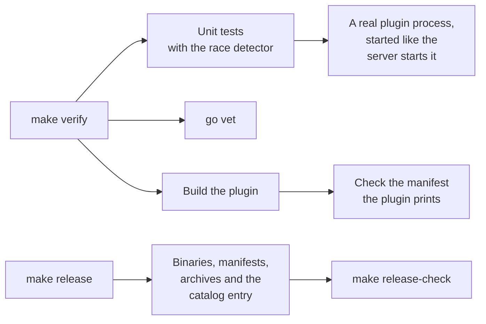

# What the plugin's checks prove

> What the repository's own checks establish for the Pastime plugin, and what they do not.
> Written for plugin 0.4.1.

The repository's checks run on every push and pull request, and again before a
release is published. This page walks through what they cover in plain words, what they leave open, and then, for
developers, each check in detail.

## What the checks cover

Everything runs against **fake Pastime servers** made for the tests. No real accounts,
keys or servers are used.

- **The names stay the same.** Plays, playback and lists get exactly the names the old
  integration gave them, so nothing is counted twice after the upgrade.
- **Keys stay safe.** A malformed key never reaches Pastime, a key that names another
  profile is refused, and no key appears in a log or an error.
- **The address setting is read correctly**, and nothing is sent without it.
- **Every Pastime reply** in the [answers table](protocol.md#answers) gives the answer
  the table says.
- **Lists only add**, even when Pastime says a list is complete.
- **A real plugin process** starts and answers the way Bloem Server needs it to.
- **A release is consistent**: each archive's manifest describes the binary inside it,
  and the catalog entry reads the way Bloem Server reads the catalog.

## What the checks do not prove

- Upgrading an installation that runs 0.1.14 on a server without the managed-tracking
  extension.
- How a real Pastime release A answers: rolling key expiry, `catalog_pending`,
  `catalog_item_id` and `service_access_required`.
- Matching titles against a live Pastime catalog.
- A rehearsal on a copy of a production database.

## Words used in the code

| On this page | In the code |
| --- | --- |
| Fake Pastime servers | `httptest` servers in the `internal/client`, `internal/provider` (`fake_test.go`) and `cmd/bloem-pastime` tests |
| The names stay the same | `internal/provider/ids_test.go` |
| The real plugin process | `TestRealProcessStartsLikeSiloStartsIt` (`cmd/bloem-pastime/transport_test.go`) |
| The manifest check | `scripts/check-manifest.py`, `TestManifestIsOnePlainWatchSyncCapability` |
| The release check | `scripts/releasecheck` |

## For developers

What the repository's own checks establish. Everything runs against
synthetic Pastime servers; no production accounts, keys or deployments are used.

`make verify` (race detector on every package, `go vet`, build, manifest check):

- **Legacy IDs.** Entity and consumption IDs equal the golden vectors and a verbatim
  copy of the removed host function, including encoding/json's HTML escaping and
  awkward inputs (quotes, line separators, invalid UTF-8). Revisions are Unix
  microseconds and zero at or before the epoch. The wire event ID is the payload
  digest. (`TestIDsMatchLegacyGoldenVectors`, `TestStableTupleKeepsDefaultHTMLEscaping`,
  `TestStableTupleMatchesLegacyForAwkwardInputs`, `TestRevisionIsUnixMicroseconds`,
  `TestWireEventIDIsPayloadDigest`.)
- **Credentials.** `ExchangeAPIKey` returns exactly the legacy credential shape (key
  plus `instance_id`, `account_id`, `profile_id`; no expiry, refresh token, type or
  scopes) and the account's username. A credential with the legacy shape drives every
  call. Malformed keys never reach Pastime. Stored attributes that differ from
  Pastime's binding are refused. `RefreshCredentials` asks for a reconnect;
  authorization-code calls are refused. The plugin never returns
  `updated_credentials`. (`TestExchangeAPIKeyStoresTheLegacyCredentialShape`,
  `TestExchangeAPIKeyFaults`, `TestGetAccount`, `TestNoRefreshAndKeyOnly`,
  `TestStoredCredentialsMustMatchPastimeBinding`.)
- **Address setting.** Read only from the call's `values["pastime.pastime_url"]`;
  https origins only, loopback http only with `BLOEM_PASTIME_ALLOW_LOOPBACK_HTTP=1`; a
  missing or invalid address sends nothing and is a TEMPORARY batch fault. `Configure`
  accepts any settings. (`TestParse`, `TestLoopbackHTTPNeedsTheOverride`,
  `TestOriginReadsTheFlattenedInstallationSetting`, `TestAddressSettingIsRequired`,
  `TestConfigureAcceptsAnySettings`.)
- **Playback.** Completed stops and history exports carry the legacy consumption ID; a
  completion without a watch-history ID is rejected without a request; a completion
  without a runtime sends duration 1; episodes need series IDs and numbers; future and
  pre-epoch times are rejected; replays (`play_recorded=false`) and `stale` answers are
  NO_CHANGE; identical retries repeat the wire ID and changed payloads get a new one.
  (`TestCompletedPlayCarriesLegacyIDs`, `TestHistoryExportsAndCompletionRules`,
  `TestEpisodesNeedSeriesIDsAndNumbers`, `TestFutureAndPreEpochOccurrencesAreRejected`,
  `TestReplayedOrStalePlaybackIsNoChange`, `TestWireIDsFollowThePayload`.) A batch of
  no events or more than 100 is INVALID_REQUEST (`TestBatchBounds`).
- **Fault table.** Every row of [the answers table](protocol.md#answers). A
  catalog-loading answer retries only its event; a 500 retries only its event while
  Pastime still answers `credentials:inspect` and fails the batch otherwise; an unknown
  503, gateway error, transport failure or broken contract fails the batch and stops
  sending; a 429 defers the rest of the batch without sending it; events that no longer
  fit before the call's deadline are deferred unsent; no sync answer is
  PERMISSION_DENIED. (`TestFaultTable`, `TestSyncFaultsForReads`,
  `TestConnectFaultsReportPermissionDenied`, `TestOnlyInternalErrorsAreEventScoped`,
  `TestSafeMessagesNameSiloAndNoSecrets`, `TestCatalogLoadingRetriesOnlyThatEvent`,
  `TestServiceFailureFailsTheWholeBatch`, `TestInternalErrorRetriesOnlyThatEvent`,
  `TestInternalErrorDuringAnOutageFailsTheBatch`, `TestDeadlineDefersTheRest`,
  `TestNoTimeLeftSendsNothing`, `TestRateLimitDefersTheRestWithoutSending`,
  `TestConnectionFailures`.) Every safe message is at most 200 characters long and never
  contains "Bloem", "managed" or key material (`ptb`), which is why the messages say
  "Silo".
- **Personal state.** Legacy lane entities; no watchlist position; scheduled removals
  resolve `imdb:`, `tmdb:`, `tvdb:` and `catalog:` keys and use the receive time; other
  keys and episodes are rejected; odd ratings are rejected.
  (`TestPersonalChangesUseLegacyEntitiesAndNoPosition`,
  `TestScheduledRemovalsResolveTheirKey`, `TestRatingsMustBeWholeStars`,
  `TestPersonalResultsAndRejections`.)
- **Remote state.** `complete_snapshot` is always false and tombstones are dropped, even
  when Pastime sends a complete snapshot; paging tokens and cursors pass through; items
  outside the closed shape fail the read as TEMPORARY; `rating_precision`, 429 and
  expired traversals map as documented. (`TestRemoteStateIsAdditionsOnly`,
  `TestRemoteStatePagesPassThrough`, `TestRemoteStateRejectsDataOutsideTheContract`,
  `TestRemoteStateFaults`.)
- **HTTP client.** One `Authorization` header and no identity headers; closed-schema
  decoding with a 1 MiB cap; error codes read from bounded bodies only; `Retry-After`
  seconds and dates capped at 5 minutes; redirects refused; errors never contain keys
  or bodies. (`TestRequestsCarryOnlyTheKeyAndAClosedBody`,
  `TestErrorsKeepStatusCodeAndRetryAfterOnly`, `TestRetryAfterDate`,
  `TestResponsesOutsideTheContractAreInvalid`, `TestApplyAcceptsOnlyKnownStatuses`,
  `TestInvalidKeysAndUnreachableOriginsNeverSend`, `TestReadPersonalStatePaging`.)
- **Real process.** The race-built binary started through go-plugin the way Silo's
  plugin host starts it: `manifest` output carries the binary's sha256,
  `BindHostBroker` succeeds with an unused broker, the live manifest is `proto.Equal`
  to the printed one, `Configure` accepts the address, then `ExchangeAPIKey`, a history
  export with the golden consumption ID, a call whose 20-second deadline leaves no room
  for a request (the event comes back RETRY/RATE_LIMITED unsent, proving the deadline
  reaches the plugin), and an incremental favourites read. Stderr shows no data race
  and no key. (`TestRealProcessStartsLikeSiloStartsIt`.) One difference from Bloem
  Server: the test starts the process with its own whole environment plus
  `BLOEM_PASTIME_ALLOW_LOOPBACK_HTTP=1`, while Bloem Server's plugin host passes only
  an allowlisted environment (`internal/pluginhost/process_env.go`, Silo #3037).
- **Manifest.** One API-key `watch_sync_provider.v1` capability with ID `pastime`, no
  metadata, no per-connection settings, and a required public `pastime.pastime_url`
  installation setting. (`scripts/check-manifest.py`,
  `TestManifestIsOnePlainWatchSyncCapability`.)

`make release` and `make release-check` (also in CI): each archive's `manifest.json`
is `proto.Equal` to what its binary reports and its checksum is the binary's sha256;
the native archive's binary is run and its output must equal `manifest.json` byte for
byte; `checksums.txt`, `supported_platforms` and the release platforms agree; the
Makefile, `manifest.json` and `main.go` versions agree. `make release` also writes
`catalog-entry.json`, the bloem-plugins entry in Silo's wire format (the binary's
manifest through `encoding/json`: snake_case keys, enum numbers), and release-check
decodes it, and any `CATALOG=` file, the way Silo decodes the catalog index. Unit
tests cover tampered archives (wrong platforms, wrong version, changed binary) and
catalog entries, including an enum name or camelCase key that protojson would accept
and Silo would not. (`TestPackedArchivesPassAndTamperingFails`,
`TestCatalogEntryMustMatch`.)

Not established here: an upgrade of an installation running 0.1.14 on a Silo server
without the managed-tracking extension, real Pastime release A responses (rolling
expiry, `catalog_pending`, `catalog_item_id`, `service_access_required`), live catalog
matching, and a rehearsal on a production dump. The scratch end-to-end plan in the
replacement contract, which is not in this repository, covers the first two.

Related pages:

- [The Pastime sync protocol](protocol.md) and its [answers table](protocol.md#answers).
- [How the Pastime plugin works inside](architecture.md).
- [How the Pastime plugin works](../README.md#build-and-check): the build and release
  commands.
